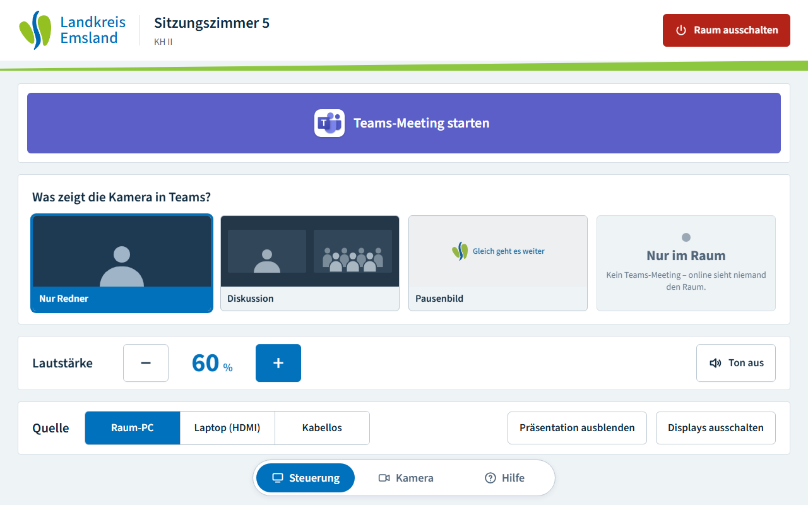
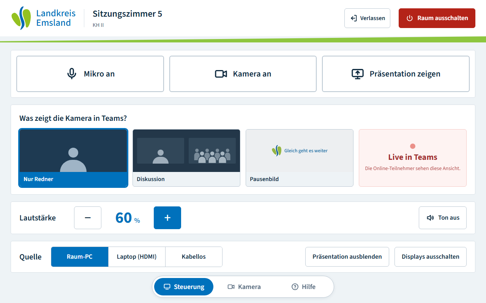
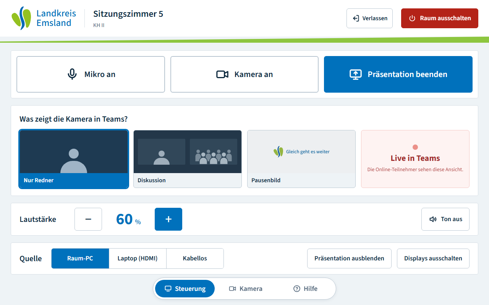

# Kontext für die Einrichtung am Raum-PC (Stand 22.10.2026)

Repo `github.com/godzilashow/raumsteuerung`, Branch `claude/modest-mayer-tbnbre`. Antworte dem Nutzer auf Russisch.
Ausführliche Doku: `ANLEITUNG.txt` (Abschnitt 9 j–p, 10), `UEBERGABE.md` („Nächster Schritt“, Punkt 6), `TECHNIK.md`.

## Aktuelles Schema: „Präsentation zeigen“ (nicht mehr nur Virtuelle Kamera)

Teams bekommt das Bild in **zwei Kanälen** (wie Teams Rooms):

1. **Personen** = Teams-Kamera = OBS Virtuelle Kamera (OBS-Programm). Szenen: „Nur Redner“ (Standard), „Diskussion“
   (Redner + Publikum), „Pausenbild“.
2. **Präsentation** = Teams „Teilen“ eines eigenen, unsichtbaren Bildschirms. OBS zeigt dort die Szene **„Inhalt“**
   (nur die Präsentation auf dem Emsland-Hintergrund) als Vollbild-Projektor; Teams teilt diesen Bildschirm
   („Nur Inhalt“, „Sound einschließen“). Folien kommen scharf, die Kamera flüssig.

## So sieht das Tablet im Modus „teilen“ aus

| Raum an, kein Meeting | Im Meeting | Präsentation wird gezeigt |
|---|---|---|
|  |  |  |

- „Raum starten“ → Kamera-Szene „Nur Redner“.
- Großer Knopf **„Teams-Meeting starten“** → `teams-steuerung.ps1` tritt dem Raum-Meeting bei (`teams-link.txt`),
  **nur mit Kamera**, ohne Teilen.
- Im Meeting drei große Knöpfe: **Mikro / Kamera / „Präsentation zeigen“** (`r5_tcmd` = `share_on`/`share_off`,
  Zustand `r5_t_share`). „Verlassen“ klein oben neben „Raum ausschalten“ (beendet vorher das Teilen).
- Im Modus „teilen“ (`r5_t_mode`, gemeldet von `teams-steuerung.ps1`) blendet das Tablet **„Alles im Blick“ und
  „Folien groß“ aus** – die Folien kommen über das Teilen. Steht `r5_t_mode` auf „kamera“ oder ist leer, sieht man
  alle 5 Ansichten und **keinen** Knopf „Präsentation zeigen“ (alter Weg).

## Wenn „Alles im Blick“/„Folien groß“ sichtbar sind und „Präsentation zeigen“ fehlt

Dann meldet `teams-steuerung.ps1` kein `r5_t_mode = teilen`. Prüfen:

1. `http://127.0.0.1:8000/api/custom-variable/r5_t_mode/value` muss `teilen` liefern. „Not found“ = Companion-Konfig zu
   alt → `Raum5_Companion.companionconfig` aus diesem Branch neu importieren („Import Preserving Unselected“), danach
   OBS-Verbindung (WebSocket-Passwort) in Companion prüfen.
2. Läuft `teams-steuerung.ps1`?
   `Get-CimInstance Win32_Process -Filter "Name='powershell.exe'" | ? CommandLine -match 'teams-steuerung'`.
   Sonst Aufgabe „Raumsteuerung Teams-Steuerung“ starten bzw. ab- und wieder anmelden. **Nicht** innerhalb eines
   Hintergrund-Jobs starten (stirbt beim Beenden des Jobs mit). Log `C:\Raumsteuerung\teams-steuerung.log`,
   `teams-steuerung.ps1 -Status` muss „Modus: teilen“ zeigen.
3. `C:\Raumsteuerung\mikro-automatik.json` darf kein `"teamsBild": "kamera"` enthalten.
4. `C:\Raumsteuerung\raumsteuerung.html` = aktuelle Version aus dem Branch; danach Seite auf dem Tablet neu laden.
5. Teilen-Bildschirm einrichten (unten), dann `pruefen.cmd` → Zeile „Teilen-Bildschirm“ grün.

## Was der PC für „teilen“ braucht

- **Virtual Display Driver:** `winget install --id VirtualDrivers.Virtual-Display-Driver -e`, danach „VDD Control.exe“
  (im WinGet-Packages-Ordner) **als Administrator** → „Install Driver“. Anzeige „Erweitern“, 1920×1080, in den
  Anzeigeeinstellungen **ganz außen** anordnen (sonst sperrt die Maus-Sperre den Weg zu anderen Monitoren).
  Monitorname enthält „MTT“ (= Standard von `teilenBildschirm`). Alternativ HDMI-Dummy → dessen Monitorname in
  `mikro-automatik.json` → `teilenBildschirm`.
- **OBS-Szene „Inhalt“** (in `Raum5_OBS_Szenen_Backup.json`), Quelle Monitoraufnahme bzw. Capture-Karte.
- **Companion-Konfig** aus `tools/companion_config.py`: Button 1/3/9 öffnet den Projektor „Inhalt“ (custom_command
  `OpenSourceProjector`, Monitor-Nr. `r5_proj_mon`); Variablen `r5_t_mode`, `r5_t_share`, `r5_proj_mon`.
- **`teams-steuerung.ps1`** (läuft als Benutzer): teilt den richtigen Bildschirm (merkt den Teams-Listeneintrag in
  `teilen-eintrag.txt`), schützt den Teilen-Bildschirm (Maus gesperrt, Fenster zurück, Projektor oben), schaltet einen
  abgeschalteten Teilen-Bildschirm selbst wieder ein, lässt OBS-Projektoren nie auf echten Monitoren, legt Teams auf
  den Sprecherplatz-Monitor (`teamsBildschirm`), klickt bei OBS „Absturz erkannt“ „Im normalen Modus starten“.
- Fehlt der Teilen-Bildschirm: Tablet zeigt „Präsentation nicht geteilt – am Rednerplatz in Teams Teilen tippen“;
  Kamera und Mikro laufen weiter.

## Nicht im Repo (von Hand)

- `C:\Raumsteuerung\teams-link.txt` – Link des **echten** Raum-Meetings.
- OBS-WebSocket-Passwort in Companion (Verbindung „obs“).
- Virtual Display Driver (siehe oben).

## Noch offen (mit der echten Hardware entscheiden)

- Welche Quelle „Präsentation zeigen“ zeigt: Standard = Bildschirm ohne Teams; Auswahl über die Tablet-Quelle
  Raum-PC / Laptop (HDMI) / Kabellos, letzte Wahl merken – noch nicht gebaut.
- Vorschlag, nicht angewendet: Pausenbild-Kachel dunkelblau wie die echte OBS-Pause, Status-Kachel ohne Kartenrahmen.

## Erfahrungen vom Test-Laptop

- Companion und Teams brauchen Autostart („Run at login“ / „Teams automatisch starten“).
- Tests mit `API_PORT=8100 PAGE_PORT=8180`, wenn der echte Companion läuft (8000/8080 belegt).
- Auf einem ausgelasteten PC (Teams im Meeting + OBS) schlagen zeitabhängige Tests gelegentlich fehl – Wiederholung
  allein genügt dann.
